# Домашнее задание к занятию  «Безопасность в облачных провайдерах» - Студент группы FOPS-42 Власов Владимир

Используя конфигурации, выполненные в рамках предыдущих домашних заданий, нужно добавить возможность шифрования бакета.

---
## Задание 1. Yandex Cloud   

1. С помощью ключа в KMS необходимо зашифровать содержимое бакета:

 - создать ключ в KMS;
 - с помощью ключа зашифровать содержимое бакета, созданного ранее.
2. (Выполняется не в Terraform)* Создать статический сайт в Object Storage c собственным публичным адресом и сделать доступным по HTTPS:

 - создать сертификат;
 - создать статическую страницу в Object Storage и применить сертификат HTTPS;
 - в качестве результата предоставить скриншот на страницу с сертификатом в заголовке (замочек).

Полезные документы:

- [Настройка HTTPS статичного сайта](https://cloud.yandex.ru/docs/storage/operations/hosting/certificate).
- [Object Storage bucket](https://registry.terraform.io/providers/yandex-cloud/yandex/latest/docs/resources/storage_bucket).
- [KMS key](https://registry.terraform.io/providers/yandex-cloud/yandex/latest/docs/resources/kms_symmetric_key).

--- 

## Выполнение пункта 1 задания 1. Yandex Cloud 

Используя конфигурации, выполненные в рамках [предыдущего домашнего задания](https://github.com/wlasoff/netology-devops-home-balance) 

1. Для того что бы с помощью ключа в KMS зашифровать содержимое бакета:
   - первым делом создаю ключ в KMS прописывая параметры в отдельном файле [kms.tf ](./conf/kms.tf):
 ```
 resource "yandex_kms_symmetric_key" "bucket_encryption" {
  name               = "${var.bucket_name}-encryption-key"
  description        = "Ключ для шифрования бакета ${var.bucket_name}"
  default_algorithm  = "AES_256"
  rotation_period    = "8760h" # 1 год
  deletion_protection = false
 ```
 и ключ автоматически создается:
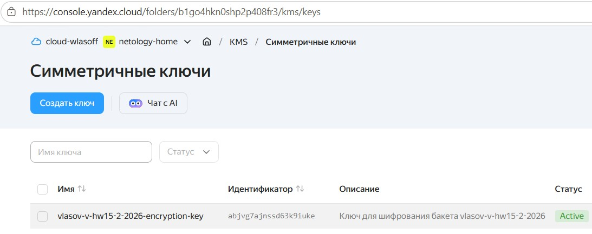

 - для того чтобы все объекты в вашем бакете автоматически шифровались при загрузке новым ключом из KMS, добавим файле [backet.tf ](./conf/backet.tf):
```
 server_side_encryption_configuration { 
	rule{
	  apply_server_side_encryption_by_default {
            sse_algorithm = "aws:kms"
              kms_master_key_id = yandex_kms_symmetric_key.bucket_encryption.id
}
 ```

- проверим, что объект действительно зашифрован командой:
```
  $ curl -sI https://storage.yandexcloud.net/vlasov-v-hw15-2-2026/Vladimir_Vlasov.jpg | head -3
 ```
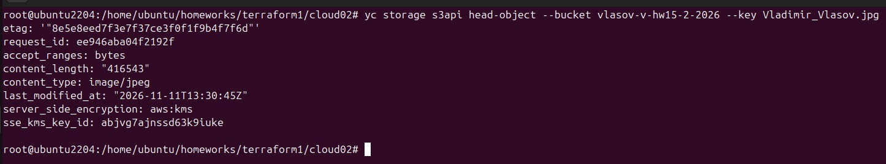

или на YC:
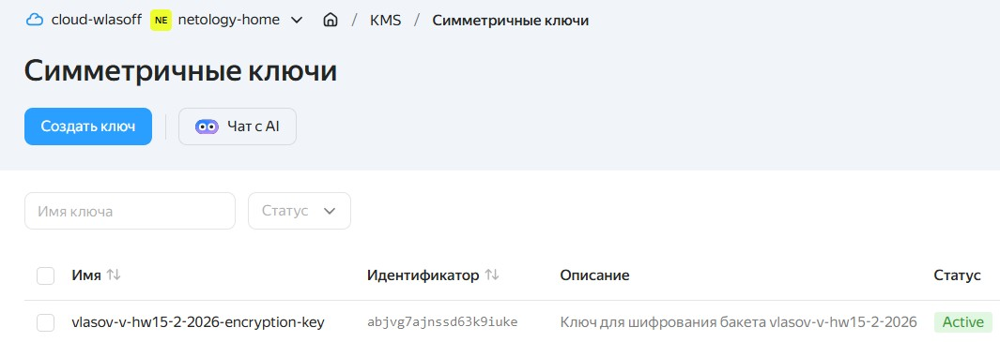

 видим то, что sse_kms_key_id объекта совпадает с идентификатором созданного ключа — файл зашифрован именно им.

Доступность объекта не изменилась и расшифровка происходит на стороне Object Storage прозрачно для клиента, поэтому публичная ссылка продолжает работать:

```
curl -sI https://storage.yandexcloud.net/vlasov-v-hw15-2-2026/Vladimir_Vlasov.jpg | head -3
 ```

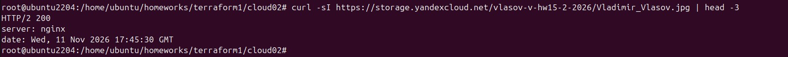

## Выполнение пункта 2 задания 1. Yandex Cloud 

Будем использовать домен hw15.vlasov.tech, файлы страницы лежат [тут](./site/).

Создаю статический сайт в Object Storage c собственным публичным адресом и сделать доступным по HTTPS:

- переходим в yandex.console Object Storage.

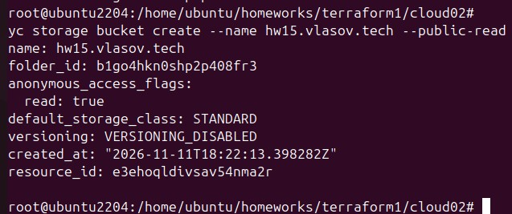

- загрузим страницы в наш банкет:

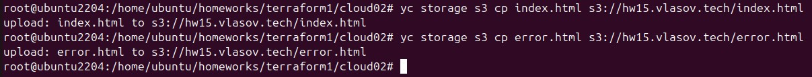

- видим идентификатор шифрования страница ошибки - error.html.
  
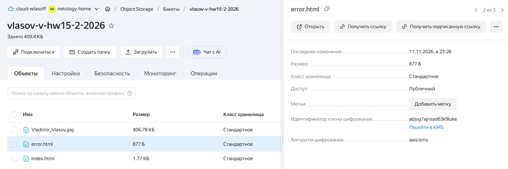
  
- разрешим доступ при помощи KMS:
  
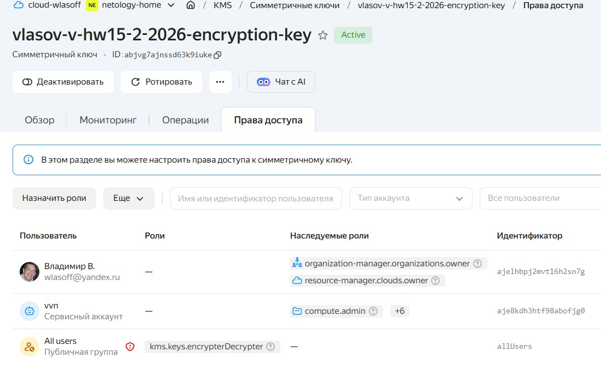

- ранее была ошибка access denied

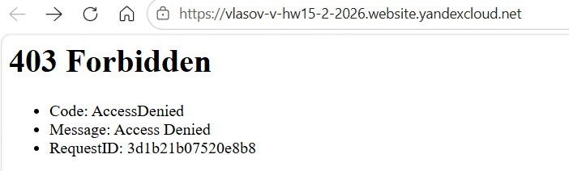

- теперь ошибка access denied изчезла

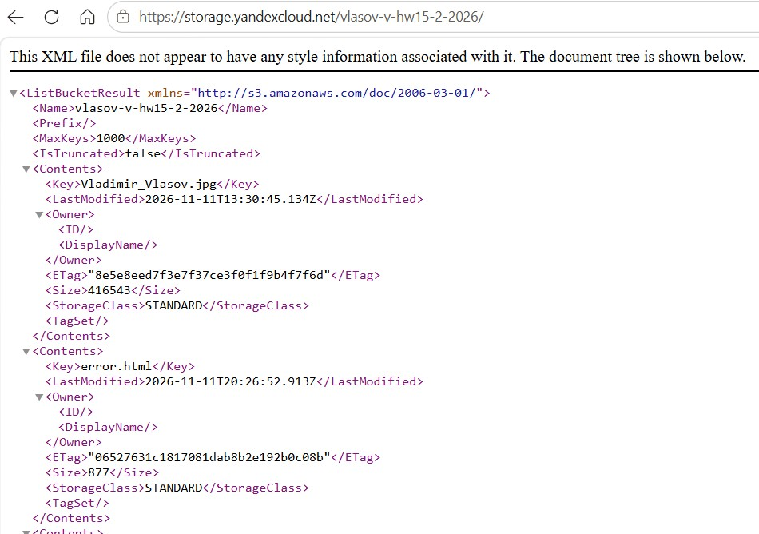

- можем также видеть содержимое бакета

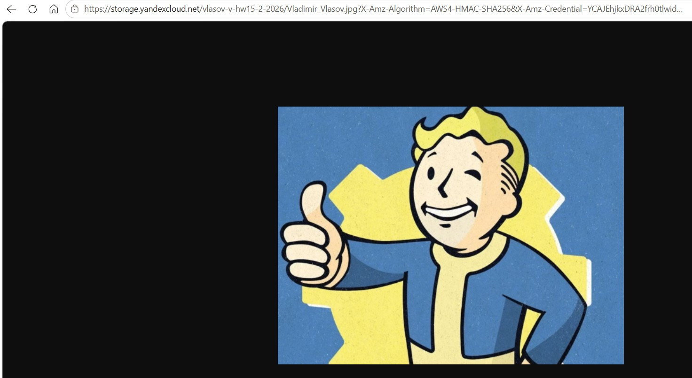

- если добавим KMS роль Viewer

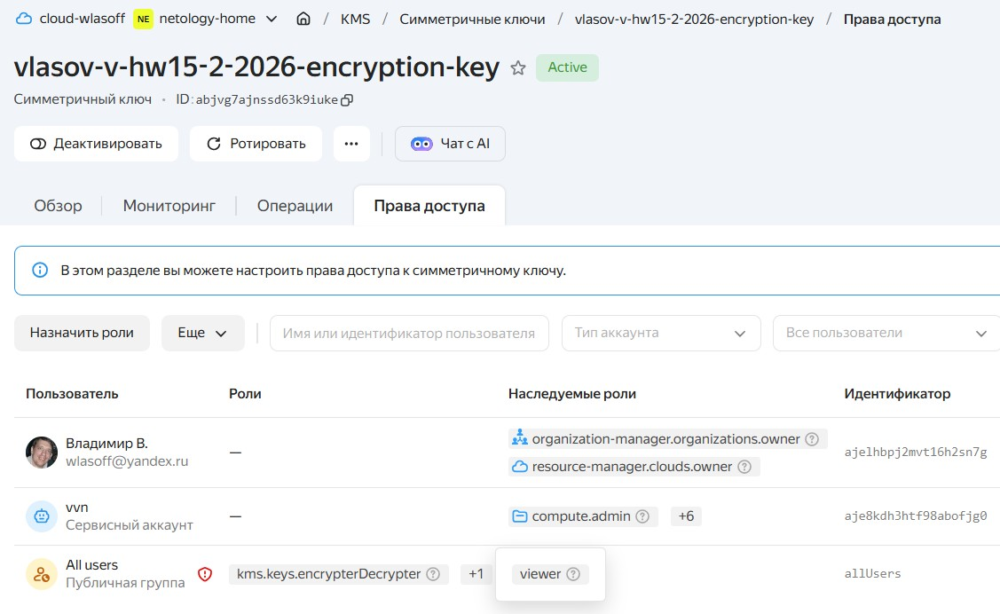

- Теперь видим, что наш сайт открывается и подписан сертификатом

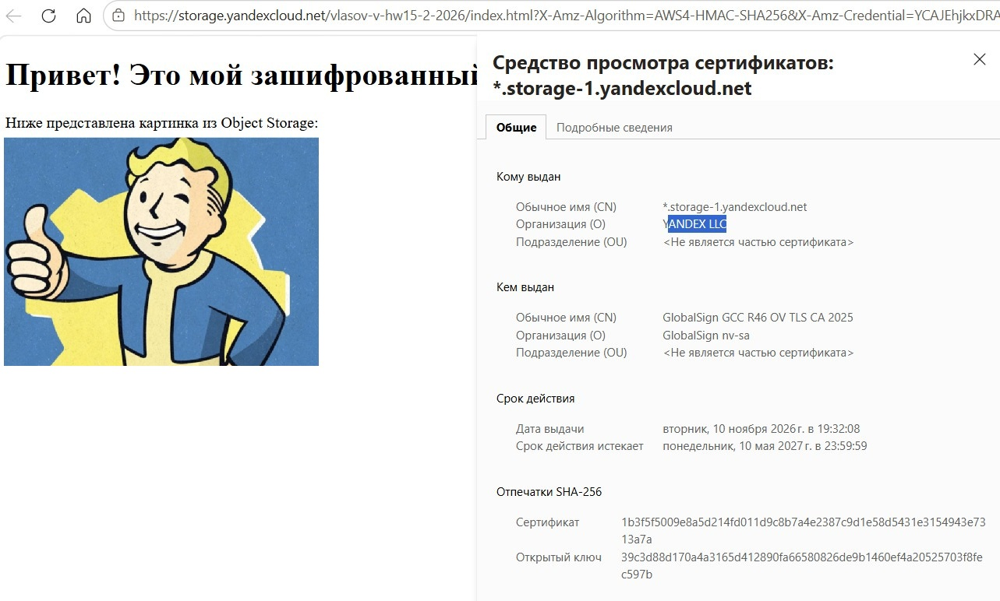

