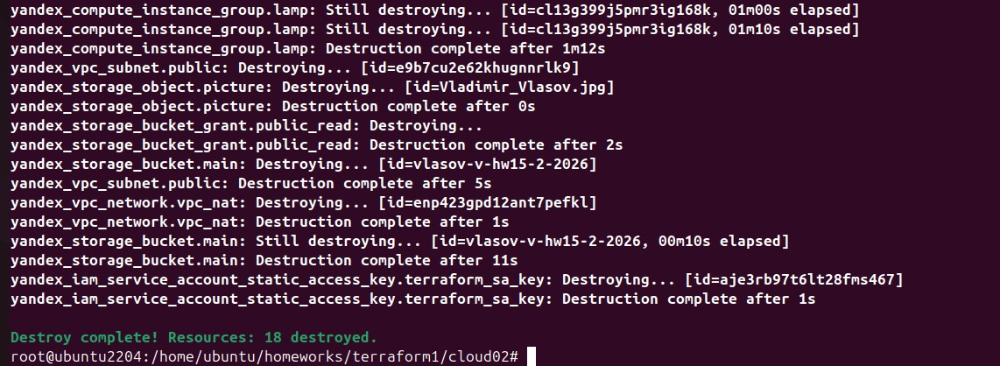

# Домашнее задание к занятию  «Безопасность в облачных провайдерах» - Студент группы FOPS-42 Власов Владимир

Используя конфигурации, выполненные в рамках предыдущих домашних заданий, нужно добавить возможность шифрования бакета.

---
## Задание 1. Yandex Cloud   

1. С помощью ключа в KMS необходимо зашифровать содержимое бакета:

 - создать ключ в KMS;
 - с помощью ключа зашифровать содержимое бакета, созданного ранее.
2. (Выполняется не в Terraform)* Создать статический сайт в Object Storage c собственным публичным адресом и сделать доступным по HTTPS:

 - создать сертификат;
 - создать статическую страницу в Object Storage и применить сертификат HTTPS;
 - в качестве результата предоставить скриншот на страницу с сертификатом в заголовке (замочек).

Полезные документы:

- [Настройка HTTPS статичного сайта](https://cloud.yandex.ru/docs/storage/operations/hosting/certificate).
- [Object Storage bucket](https://registry.terraform.io/providers/yandex-cloud/yandex/latest/docs/resources/storage_bucket).
- [KMS key](https://registry.terraform.io/providers/yandex-cloud/yandex/latest/docs/resources/kms_symmetric_key).

--- 


## Выполнение задания 1. Yandex Cloud 

Используя конфигурации, выполненные в рамках [<предыдущего домашнего задания>](https://github.com/wlasoff/netology-devops-home-balance) 

1. Для того что бы создать бакет Object Storage и разместить в нём файл с картинкой, для этого:

- добавляем права доступа для сервисного аккаунта;


- создаем бакет в Object Storage с произвольным именем (например, _имя_студента_дата_);


- выгрузим в бакет файл с картинкой;


 
- сделаем картинку доступной из интернета;


[<Тут конфигурация Bucket'a>](./cfg/bucket.tf)


- Права доступа на картинку;


2. Создаем группу ВМ в public подсети фиксированного размера с шаблоном LAMP и веб-страницей, содержащей ссылку на картинку из бакета:


 - Создаtv Instance Group с тремя ВМ и шаблоном LAMP, где для LAMP рекомендуется использовать `image_id = fd827b91d99psvq5fjit`.
 

 
 - Для создания стартовой веб-страницы рекомендуется использовать раздел `user_data` в [meta_data](https://cloud.yandex.ru/docs/compute/concepts/vm-metadata).
 
[Задаем параметры cloud-init ](./conf/instance-group.tf)

- При помощи cloud-init задаем насройку при первом запуске VM  где   <h1>LAMP Instance Group</h1>
      

 - Размещаем в стартовой веб-странице шаблонной ВМ ссылку на картинку из бакета.
 
После запуска ВМ страница c картинкой доступна по http://51.250.90.54/


или по http://51.250.13.175/


или по http://51.250.84.142/


Запись производится в корень index.html
 ```
 write_files:
  - path: /var/www/html/index.html
    content: |
 ```

 - Настроим проверку состояния ВМ.

Прописывается в instance-group.tf
```

  health_check {
    interval            = 5
    timeout             = 4 #  таймаут должен быть меньше интервала (5 сек)
    healthy_threshold   = 3 #  здесь три проверки что все окей работает
    unhealthy_threshold = 2 #  проверка на неработу, недоступность по 80 порту
    tcp_options {
      port = 80
    }

*    - health_checks_spec.health_check_specs[0].unhealthy_threshold: Value must be one of [0, 2, 3, 4, 5, 6, 7, 8, 9, 10]


Логика:

healthy_threshold = 3 — нужно три успешные проверки подряд, чтобы ВМ признали здоровой (15 секунд: 3 × 5)

unhealthy_threshold = 2 — достаточно одной неудачной проверки, чтобы ВМ признали нездоровой (10 секунд)

Группа быстро реагирует на отказ и сразу начинает замену. 

Если ВМ перестаёт отвечать на порт 80 три проверки подряд, группа автоматически заменяет её новой.

```


3. Подключаем группу к сетевому балансировщику:

 - создаем сетевой балансировщик [Сетевой блансировщик](./conf/load-balancer.tf)


 - проверяем работоспособность, удалив одну или несколько ВМ


ВМ удаляется


Пропал публичный IP у ВМ


Нет доступа к сайту по http://51.250.90.54/


ВМ пересоздается с новым публичным IP 51.250.80.7:


Появился доступ к сайту по новому адресу http://51.250.80.7/


[<Файлы для terraform>](./cfg/)

Удаляем все ресурсы на Yandex Cloud командой

```bash
 terraform destroy
   ```


